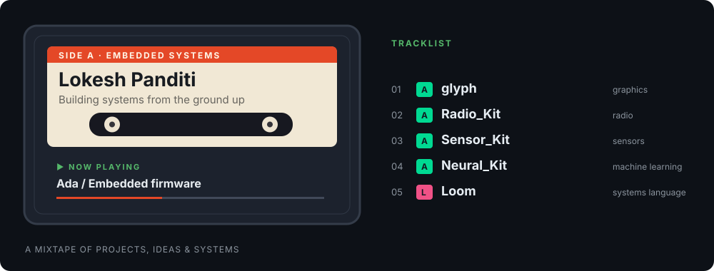
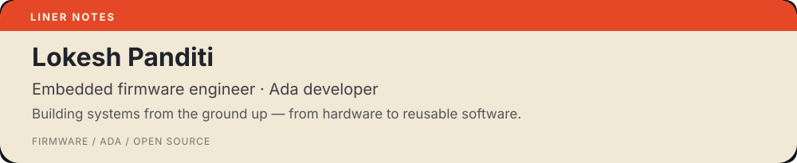
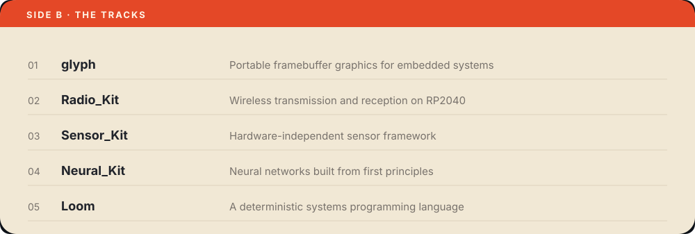
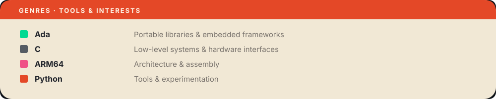

[ glyph ](https://github.com/thirstymelon/glyph) · [ Radio_Kit ](https://github.com/thirstymelon/Radio_Kit) · [ Sensor_Kit ](https://github.com/thirstymelon/Sensor_Kit) · [ Neural_Kit ](https://github.com/thirstymelon/Neural_Kit) · [ Loom ](https://github.com/thirstymelon/Loom)

[GitHub](https://github.com/thirstymelon) · [Website](https://lokeshpanditi.qzz.io) · [LinkedIn](https://www.linkedin.com/in/lokeshpanditi) · [Email](mailto:lokesh.panditi.29@gmail.com)

Mixtape · Building systems from the ground up.
